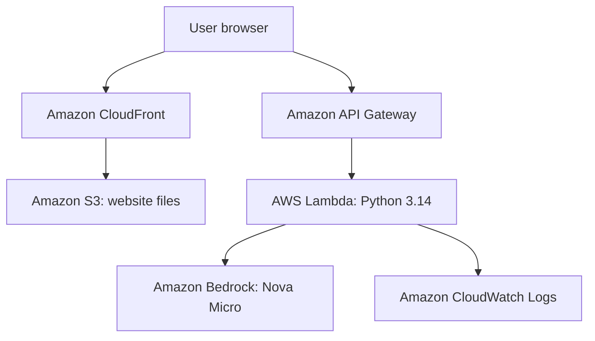

# CloudTech UI Help Desk

A serverless help desk web application built with Amazon S3, CloudFront, API Gateway, AWS Lambda, and Amazon Bedrock.

Users submit IT support questions through a web interface. The backend is designed to send each question to Amazon Nova Micro and return troubleshooting advice.

## Architecture



CloudFront delivers the website stored in S3. JavaScript in the browser sends questions to API Gateway, which invokes Lambda. Lambda calls Bedrock and returns a JSON response.

## Services

| Service | Purpose |
|---|---|
| Amazon S3 | Stores the frontend |
| Amazon CloudFront | Delivers the website over HTTPS |
| Amazon API Gateway | Connects the browser to Lambda |
| AWS Lambda | Validates requests and calls Bedrock |
| Amazon Bedrock | Provides the generative AI model |
| AWS IAM | Controls backend permissions |
| Amazon CloudWatch Logs | Records execution logs and errors |

## Repository Files

- `frontend/index.html` — website interface and API request code.
- `backend/lambda_function.py` — Python Lambda backend.
- `.gitignore` — excludes common Python development files.

## Current Status

- Website hosting and API connectivity were tested with a static response.
- Lambda was upgraded from Python 3.10 to Python 3.14.
- The upgraded function executes and validates incoming messages.
- A test containing a message reaches the Bedrock Converse call.
- AI-generated responses are currently blocked by an account quota restriction.
- An AWS Support case has been submitted.
- CI/CD is planned and has not yet been configured.

The observed Bedrock error is:

```text
ThrottlingException: Too many tokens per day, please wait before trying again.
```

During investigation in `us-east-1`, the applied on-demand Nova Micro requests-per-minute and tokens-per-minute quotas both showed `0`.

End-to-end AI response testing remains pending.

## Configuration

The current backend calls:

- Region: `us-east-1`
- Model: `amazon.nova-micro-v1:0`
- API operation: `Converse`
- Lambda handler: `lambda_function.lambda_handler`

The frontend API URL must point to the deployed API Gateway endpoint.

## Deployment Outline

This project was built manually in the AWS Console. The repository currently contains application source code, not automated infrastructure provisioning.

1. Create a Python 3.14 Lambda function.
2. Deploy `backend/lambda_function.py` with the handler shown above.
3. Configure the Lambda execution role with CloudWatch logging and permission to invoke the selected Bedrock model.
4. Configure an API Gateway POST route integrated with Lambda.
5. Configure CORS to allow the frontend origin.
6. Set the API URL in `frontend/index.html`.
7. Upload the frontend contents to an S3 bucket.
8. Configure CloudFront to serve the S3 content, preferably using Origin Access Control with a private bucket.
9. Test Lambda, then the API, then the website.

Successful AI responses require model availability and sufficient account quotas.

## Test the Backend

Use this Lambda test event to simulate an API Gateway request:

```json
{
  "httpMethod": "POST",
  "body": "{\"message\":\"How do I troubleshoot a slow computer?\"}",
  "isBase64Encoded": false
}
```

Expected behavior:

- A missing or empty message returns HTTP `400`.
- A successful model request returns HTTP `200` with an `answer`.
- A caught backend exception returns HTTP `502` with a general error message.

Lambda's test status of “Succeeded” means execution completed. Always inspect the returned `statusCode` and response body.

## Troubleshooting

For a failed AI request:

1. Open the Lambda function's CloudWatch log group.
2. Open the latest log stream.
3. Find `Bedrock request failed`.
4. Expand the traceback and read the final exception message.
5. Check the relevant model quotas, permissions, region, and model ID.

## Useful Commands

Clone the repository:

```bash
git clone https://github.com/Juste91/cloudtech-ui-helpdesk.git
cd cloudtech-ui-helpdesk
```

Check Python syntax locally:

```bash
python -m py_compile backend/lambda_function.py
```

This syntax check does not invoke AWS or verify Bedrock access.

## Security and Cost Control

- Use IAM roles instead of hardcoded AWS credentials.
- Keep credentials and private configuration out of GitHub.
- Restrict permissions to the resources required.
- Restrict CORS to the intended website origin.
- Review API access controls and throttling before public use.
- Monitor AWS usage and set billing alerts.
- Remove unused resources after testing.

## Next Steps

- Resolve the Bedrock quota restriction with AWS Support.
- Verify an AI-generated answer in the website.
- Add GitHub Actions for automated validation.
- Add deployment automation using AWS OIDC authentication.
